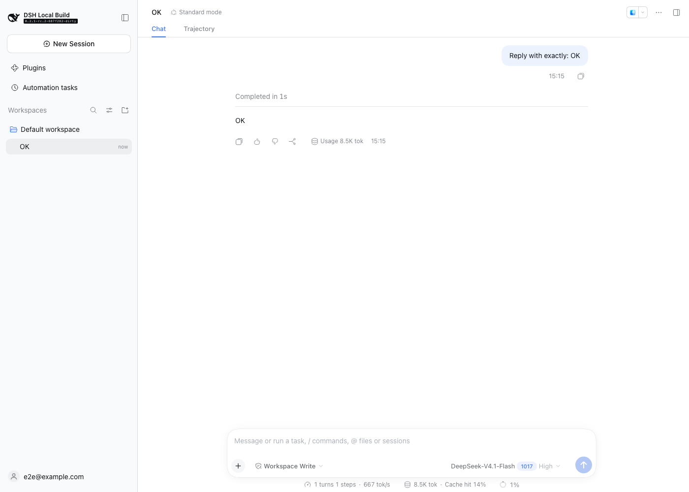

# DSH 本地参考中转站（New API + relay）

在本地跑通「DSH 登录 → 模型调用」的完整链路，作为生产中转站的参考实现与回归夹具。

```
DSH 桌面/Web
   │  登录协议 8 个 API + /models
   │  推理 POST /v1/messages（x-dsh-auth-token）
   ▼
relay（本目录，Node 22，零依赖）
   │  Authorization: Bearer <NEWAPI_KEY>
   ▼
New API（:13000，渠道/模型/计费/日志）
   │  Bearer <上游 key>
   ▼
上游模型服务
```

## 职责划分

| 组件 | 负责 |
|---|---|
| **New API** | 上游渠道、模型映射、配额/计费、日志、管理台 |
| **relay** | DSH 账户协议、PKCE、token 签发/吊销、注册登录页、`/models` schema 转换、推理代理 |

relay 是薄层：不存模型密钥，不做计费，只把 DSH 的协议翻译成 New API 的 HTTP API。

## 快速开始

### 1. 启动 New API

```bash
cd services/relay
mkdir -p data/new-api data/relay
docker compose up -d new-api
```

打开 <http://127.0.0.1:13000>，完成初始化向导，创建管理员账号。

在管理台：

1. **渠道**：新建渠道，按上游协议选类型，填入 API key。
   - DeepSeek 官方 Anthropic 入口：类型 **Anthropic (14)**，Base URL `https://api.deepseek.com/anthropic`，自定义模型 `deepseek-flash,deepseek-v4-pro`。
   - 其他 OpenAI 兼容上游：类型 OpenAI，Base URL 填到 `/v1` 之前。
2. **模型**：确认渠道模型可用；如果上游模型名与对外要暴露的名字不同，在 relay 的 `MODELS` 里配 `upstream`。
3. **令牌**：创建一个 API 令牌（`sk-...`），给它访问对应模型分组的权限。
4. **容器出网**：如果宿主机通过 `127.0.0.1` 代理出网，容器无法直接使用。用 `node tools/host-proxy.mjs 10809 10808 <宿主 LAN IP>` 做转发，再在 `.env` 配 `HTTP_PROXY/HTTPS_PROXY=http://<宿主 LAN IP>:10809`（Compose 已注入 NewAPI）。只在可信网络使用，别把转发绑到 `0.0.0.0`。

### 2. 配置并启动 relay

```bash
cp .env.example .env
# 生成会话密钥
openssl rand -hex 32   # 填到 SESSION_SECRET
# 把上一步的 New API 令牌填到 NEWAPI_KEY
```

本机直接跑（开发推荐）：

```bash
NEWAPI_BASE_URL=http://127.0.0.1:13000 npm start
# [relay] listening on http://127.0.0.1:18082
```

或全部容器化（relay 会通过 `new-api:3000` 访问）：

```bash
docker compose up -d
```

自检：

```bash
curl -s http://127.0.0.1:18082/healthz          # {"ok":true}
curl -s -o /dev/null -w '%{http_code}\n' http://127.0.0.1:18082/dsh/authorized  # 200
```

### 3. 让 DSH 使用 relay

Web（本机调试）：

```bash
DSH_HOME=~/.dsh-dev pnpm dsh web --patch custom/profiles/local-relay.patch.yml
```

桌面开发壳：把 `custom/profiles/local-relay.patch.yml` 的内容合并进
`~/.dsh-dev/profiles/desktop/cordis.patch.yml`，再 `DSH_HOME=~/.dsh-dev pnpm dev:desktop`。

打开应用 → 账户 → 登录：会打开 relay 的注册/登录页，注册后自动回到 DSH。

## 环境变量

| 变量 | 默认 | 说明 |
|---|---|---|
| `PUBLIC_ORIGIN` | `http://127.0.0.1:18082` | 浏览器和 DSH 访问的 origin；必须与 DSH 配置一致 |
| `PORT` | `18082` | 监听端口（仅 loopback） |
| `DATA_DIR` | `./data` | SQLite 数据库目录 |
| `NEWAPI_BASE_URL` | `http://127.0.0.1:13000` | New API origin |
| `NEWAPI_KEY` | 空 | New API 令牌；为空时登录可用，推理返回 503 |
| `SESSION_SECRET` | 必填 | 浏览器会话与 CSRF 的 HMAC 密钥，≥32 字符 |
| `TOKEN_TTL_DAYS` | `30` | DSH 账户 token 有效期 |
| `BRAND_NAME` | `DSH Relay` | 登录页显示名 |
| `MODELS` | 内置 `deepseek-chat` | JSON 数组；`id` 对外，`upstream` 发给 New API |
| `ALLOW_REGISTRATION` | `true` | 是否开放注册 |

## 协议实现范围

- `POST /auth-api/v0/dsh/auth_init`
- `POST /auth-api/v0/dsh/auth_exchange`（PKCE S256，code 单次、120s）
- `POST /auth-api/v0/dsh/auth_cancel`
- `GET /auth-api/v0/users/current`
- `GET /api/v0/users/get_user_summary`（空钱包）
- `GET /api/v0/users/get_unnotified_bonuses`（空数组）
- `POST /api/v0/users/ack_bonus_notified`
- `POST /auth-api/v0/users/logout`
- `GET /models`（DSH schema）
- `POST /v1/messages`（透传 SSE）
- `GET /dsh/authorize`、`POST /dsh/authorize`、`GET /dsh/authorized`
- `GET /usage`、`GET /top_up`

不支持：`/v1/files`（返回 404，DSH 会回退 inline 图片）、refresh token、多租户。

## 测试

```bash
npm test
```

覆盖：注册 → 登出 → PKCE 换 token → 模型目录 → SSE 透传 → 登出失效 → 非法回调/错误 verifier 负例。

与真实 New API 联调时，按 [登录中转站规范](../../custom/login-relay-spec.md) §9 的清单再跑一遍。

### 实测记录

- 渠道：`type=14`（Anthropic），Base URL `https://api.deepseek.com/anthropic`，模型 `deepseek-flash`、`deepseek-v4-pro`。
- 直连 NewAPI `/v1/messages`：返回真实 SSE，包含 `thinking` 块与 `signature_delta`。
- relay `/v1/messages`：同一请求经 relay 归一化后返回 `OK`，事件序列只有一个 `message_start`。
- NewAPI 的 `/v1/models` 仍缺 `api_capabilities.anthropic_messages`，所以 `/models` 继续由 relay 生成。
- DSH UI 全链路已验证：登录页注册/登录 → 回到 DSH → 发消息 → 真实 DeepSeek 返回 `OK`。
- 浏览器会按 CSP 的 `form-action` 检查表单 302 的目标；登录表单跳转到 loopback 回调，所以 CSP 必须允许 `http://127.0.0.1:*` / `http://localhost:*`，否则提交被静默拦截（已内置，并有回归测试）。



## 数据与安全

- SQLite 只存：用户邮箱、scrypt 密码哈希、token 的 SHA-256、登录事务、浏览器会话哈希。
- 账户 token 只在签发时返回一次，之后不可读。
- 登录/注册按 IP 限流（10 次/5 分钟）；表单带 CSRF。
- 生产必须：HTTPS、`SESSION_SECRET` 随机、New API 令牌最小权限、日志脱敏。
- 容器只绑定 `127.0.0.1`；要对外提供服务时，前面加 TLS 反向代理并评估限流/审计。

## 许可

- 本目录代码随仓库使用 MIT。
- New API 是 **AGPLv3**，以独立容器运行、不修改源码；不要把它的二进制与桌面安装包捆绑分发，否则会触发 AGPL 义务。

## 故障排查

### `DeepSeek Messages transport failed`

这是 DSH 的传输层错误：请求没有拿到可用的 HTTP 响应，不是模型返回的业务错误。按顺序查：

1. relay 是否在 `127.0.0.1:18082`（`curl :18082/healthz`）。
2. NewAPI 是否在 `127.0.0.1:13000`（`docker compose ps`）。
3. NewAPI 容器能否出网：如果宿主机代理只监听 `127.0.0.1`，容器会失败；用 `tools/host-proxy.mjs` 转发并把 `HTTP_PROXY/HTTPS_PROXY` 指向宿主 LAN IP。
4. 渠道模型是否包含请求的 id（`deepseek-flash` / `deepseek-v4-pro`）。

### 登录后一直显示「Waiting for sign in」

浏览器 CSP 会检查表单 302 的目标；登录页必须允许 loopback 回调（`http://127.0.0.1:*`、`http://localhost:*`）。本实现已内置，改动 CSP 时不要删掉。

### 换网络后容器出网失败

宿主 LAN IP 变了，`.env` 里的 `HTTP_PROXY` 仍是旧地址。更新后 `docker compose up -d --force-recreate new-api`，并重启转发器。
